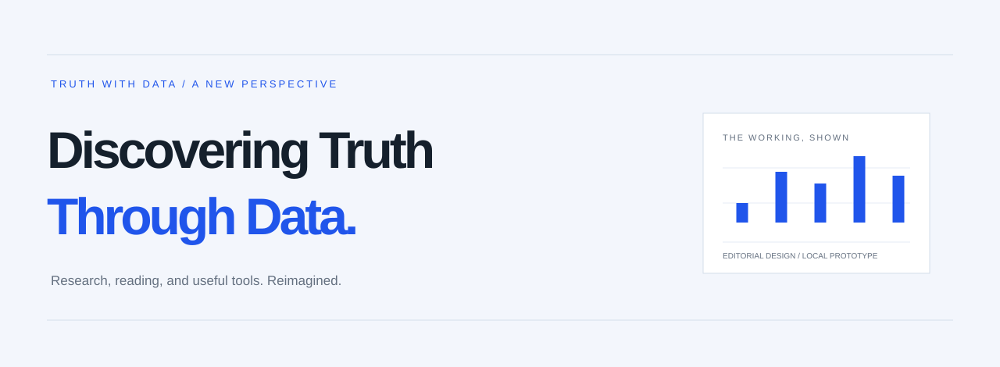

<p align="center"></p>

<p align="center"><strong>A fresh perspective on Truth with Data.</strong><br>Contemporary editorial design. Complete articles. Research you can explore. Tools you can use.</p>

<p align="center"><a href="#start-here">Run locally</a> · <a href="#inside-the-redesign">Explore the design</a> · <a href="DESIGN_PROMPT.md">Rebuild or migrate it</a> · <a href="#project-map">Project map</a></p>

---

This is a standalone redesign prototype for [Truth with Data](https://truthwithdata.com). It brings stories, tutorials, studies, calculators, and consultancy into one coherent experience. The existing production website has not been changed or deployed from this project.

## Start here

**No framework. No dependency installation. No build step.**

```sh
python3 -m http.server 8080 --bind 127.0.0.1
```

Open **http://127.0.0.1:8080**. Alternatively, open `index.html` directly in a browser. With Node installed, `npm run dev` starts the same server.

| Explore | Local route |
| --- | --- |
| The homepage | `/#/` |
| Stories and tutorials | `/#/insights` |
| Rent vs buy: full article | `/#/article/5` |
| Research studies | `/#/work` |
| The calculator workspace | `/#/tools/2` |
| Books and reports | `/#/resources` |
| Services | `/#/services` |
| Consultancy and booking | `/#/consultancy` |

## Deploy as a static HTML site

```sh
npm run build
```

Deploy the generated **`dist/`** folder to your static hosting provider. Build command: `npm run build`. Publish/output directory: `dist`. No application server, framework, or runtime dependencies are required. The browser entry point is `dist/index.html`; hash-based routes do not need server rewrites.

To inspect the deployment output locally:

```sh
python3 -m http.server 8080 --bind 127.0.0.1 --directory dist
```

The generated folder contains only HTML, CSS, JavaScript, and assets. Documentation, raw source exports, test scripts, and Git handoff files are excluded. Original chart files and the AI/housing data/model scripts remain online dependencies as described below.

## Inside the redesign

### An editorial identity

White space, dark typography, cobalt accents, and a deliberate grid. Manrope headlines and DM Sans body text give the site its voice, with system fallbacks when offline. Real research leads the experience; decorative artwork stays secondary.

### A living background, one consistent palette

The supplied [React Bits Grainient](https://reactbits.dev/c/backgrounds/grainient) effect is adapted to plain JavaScript in `grainient.js`. The shared header is transparent so the atmosphere continues behind its navigation on every route. The homepage hero reads “Discovering Truth Through Data”, with the subtitle “Transforming complex data into clear insights with rigorous analysis and statistics”. The featured housing analysis is a bordered white box; calculator panels and resource cards are also solid white. The shared header has no bottom divider. Each page uses a full-viewport backdrop in white, ice blue, cobalt, and soft slate; angle, flow, and seed provide subtle variation. It fades smoothly away as you scroll past the introduction and reappears when you return to the top. Study cards retain their distinct blue, teal, violet, and warm accents. The implementation uses Oklab color interpolation, flowing noise, a grain composite, and a gentle pointer response. It pauses offscreen and in hidden tabs, caps rendering resolution and frame rate, respects reduced motion, and falls back to a static gradient. Shader rendering still needs verification on real desktop/mobile GPUs.

### A complete reading experience

All **four articles and four studies** are imported from the supplied exports. Reading pages include a sticky contents rail, section navigation, reading progress, responsive tables, expandable code examples, and related reading. Readers stay in the redesign for the full text.

### Research with a point of view

Study cards lead with the finding, followed by the question, approach, and topic tags. Reported metrics come from the supplied content. Each study opens its full body locally.

### One workspace for useful tools

A compact selector sits on the **left**; the active calculator occupies the main panel. On smaller screens, a horizontally scrollable selector moves above the tool. The embeds measure their content rather than their own viewport to avoid resize feedback loops.

| Tool | Implementation |
| --- | --- |
| ROI | Local implementation with live results, validation, and reset |
| Sample size | Local single-proportion estimate, with optional finite-population correction |
| Descriptive statistics | Imported calculator with local calculation script |
| Standard deviation and variance | Imported calculator with local calculation script |
| Percentiles and quartiles | Imported calculator with local calculation script |
| Pearson and Spearman correlation | Imported calculator with local calculation script |
| Covariance | Imported calculator with local calculation script |
| AI job exposure | Imported interface; loads original data/runtime scripts online |
| UK rent vs buy | Imported interface; loads original data/model/runtime scripts online |

### Local prices, original purchase destinations

`currency.js` uses the supplied country-to-currency mappings, timezone/language fallback, daily currency API, 12-hour rate cache, and built-in fallback rates. Converted prices are approximate and keep their original base amount in data attributes, so returning to Resources does not compound conversions. Checkout clarification appears only for converted prices. Use `?country=IN#/resources` to preview INR or `?country=US#/resources` for USD. The optional `/api/geo` endpoint is not implemented by this static preview; missing endpoints fall back to browser locale/timezone.

Products respect `buyLink`, `checkoutUrl`, preview, details, and Amazon destinations. With no checkout URL, the book offers an explicitly labelled email enquiry. Unavailable products remain in the configuration but are omitted from the featured resource grid.

### A clear next step

A brief three-service section appears on the homepage, and a dedicated Services page is linked in the shared navigation. It includes all supplied service features and the supplied transparency note in an expandable detail. Consultancy remains accessible through booking and contextual links. Booking opens the existing Calendly destination only when clicked. Resource cards use a centered layout, consistent spacing, and aligned purchase actions.

## Make it yours

Edit **`site-config.js`** for article metadata, services, products, study summaries, tool links, and contact details. Existing fields and original destinations are preserved.

- **Visual design:** change tokens and layouts in `styles.css`.
- **Pages and interactions:** edit `app.js`.
- **Shared header and footer:** edit `index.html`.
- **Full content:** update the supplied exports, then regenerate the content bundle.
- **Booking:** the Calendly destination is declared near the top of `app.js`.

The [design and migration prompt](DESIGN_PROMPT.md) is a reusable brief for recreating this design in another stack or porting the production website. It includes the visual principles, page behaviors, migration boundaries, and acceptance checks.

## Regenerate the imports

Only the optional import scripts require Python dependencies:

```sh
python3 -m pip install -r requirements-dev.txt
python3 scripts/import_content.py
python3 scripts/import_tools.py
```

`studiesandarticles/` holds the provided source material. The article importer strips source navigation, tracking scripts, original tab controls, and forms; it preserves prose, methodology, code examples, tables, sources, and chart references. Known article-to-study links are remapped to local routes. Calculator embeds retain their calculation scripts and run inside sandboxed frames.

## Verification

```sh
npm test
```

Checks cover eight full content imports, table-of-contents anchors, nine tool selections, local embed files, page rendering, sample-size and ROI cases, stable iframe-height reporting, service navigation/data, product destinations, and currency conversion with live/offline/cached fixtures. This is a static/logic check, not a replacement for browser testing.

**Verification limits:** browser automation and the local preview server were unavailable in the implementation sandbox. Desktop/mobile visual QA and the original online model dependencies need checking in a normal browser. The imported statistical tools retain their supplied implementations; they have not undergone an independent numerical audit.

## Repository handoff

Intended remote: `https://github.com/tanmaysheoran/truthwithdata-sample-redo.git`. Publication is separate from deployment. If the implementation environment cannot reach GitHub, use the supplied Git bundle or commit this working folder from your normal terminal; do not force-push over an existing repository history.

## External dependencies and production handoff

- Source charts use original image URLs because the supplied HTML exports did not contain their image files. Offline failures show the supplied chart description. Download and serve those assets locally for a production migration.
- AI and housing tools require the original model/data JavaScript files. Vendor them into this project and rewrite their URLs for a fully self-contained version.
- The review-detection study's live demo opens the original demo; its backend/runtime was not supplied.
- Google Fonts is optional. Calendly, product previews, checkout destinations, and Amazon remain external.
- Payments, newsletter subscriptions, report-download integrations, and backend forms are not implemented here. No advertising or analytics was added to the redesign shell.
- Hash routes keep the prototype portable. A production port should preserve the current public article/tool URLs and add appropriate redirects, metadata, canonical URLs, and a sitemap.
- The source content and brand assets remain their owners’ material. `grainient.js` adapts the React Bits code supplied for this project; preserve upstream attribution and verify its applicable license before redistribution. No blanket license is asserted over the combined prototype.

## Project map

```text
index.html                  Shared shell
styles.css                  Design system and responsive layouts
grainient.js                Grainient WebGL adaptation and lifecycle
currency.js                 Local currency detection, rates and formatting
app.js                      Routes, reading UI, tool workspace, ROI/sample-size logic
site-config.js              Supplied content configuration
article-content.js          Generated full article and study bodies
assets/
  logo.png                  Existing brand asset
  tools/                    Generated standalone calculator embeds
studiesandarticles/         Supplied article, study, and calculator exports
scripts/
  import_content.py         Content import and internal-link mapping
  import_tools.py           Calculator import and frame-size reporting
  verify.cjs                Static rendering and behavior checks
  build.cjs                 Package runtime files into dist/
docs/banner.svg             README artwork
DESIGN_PROMPT.md             Rebuild and production migration brief
```

---

**Discovering Truth Through Data**
